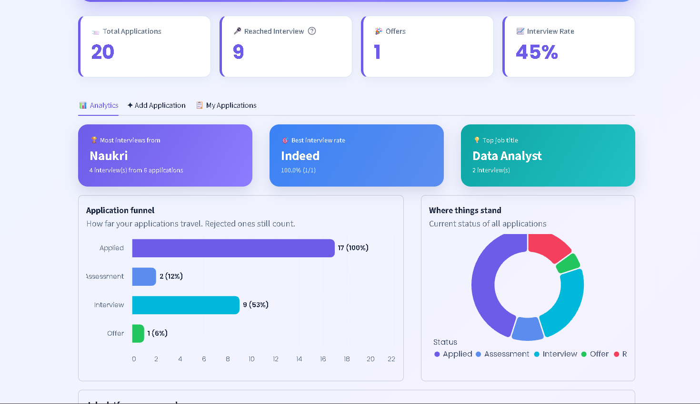
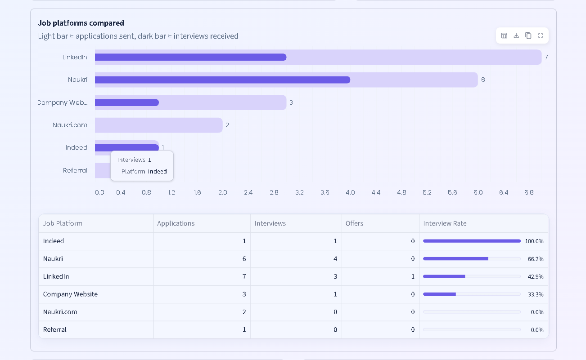
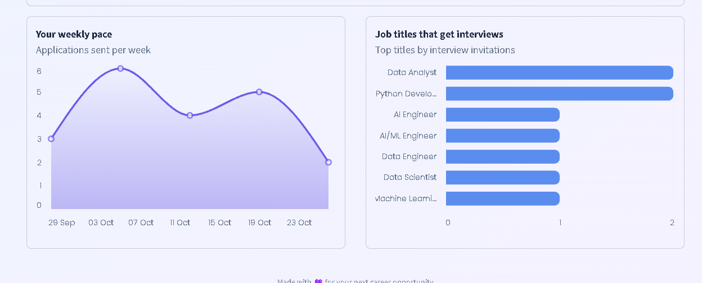

# 💼 Job Hunt Tracker & Analytics Dashboard

A Python-based web application to track job applications, monitor recruitment progress, and analyze job-search performance across different platforms.

Built with **Python, Streamlit, SQLite, and Pandas**, this project transforms job application records into useful insights through interactive metrics, charts, and tables.

## 🚀 Features

- **Job Application Management:** Add and track company names, job titles, locations, application dates, job platforms, salary expectations, and application statuses.
- **Application Status Tracking:** Monitor progress through Applied, Assessment, Interview, Offer, Rejected, and other statuses.
- **Analytics Dashboard:** View application statistics and recruitment progress.
- **Platform Performance Analysis:** Compare interview invitations from Naukri, LinkedIn, Indeed, company websites, and referrals.
- **Interview Rate Analysis:** Calculate the percentage of applications that reached the interview stage for each platform.
- **Job Title Analysis:** Identify job titles associated with the most interview invitations.
- **Time-to-Interview Analysis:** Calculate how many days it takes to receive an interview after applying.
- **SQLite Database:** Store job applications and their status-change history locally.

## 📊 Analytics Questions

The dashboard is designed to answer questions such as:

1. How many jobs have I applied for?
2. Which job platform generates the most interview invitations?
3. Which platform has the highest interview rate?
4. Which job titles receive the most interview invitations?
5. How many days does it take to receive an interview after applying?
6. How many applications have reached the offer or rejection stage?

## 🛠️ Technologies Used

- **Python** — Application logic and data processing
- **Streamlit** — Interactive web application and dashboard
- **SQLite** — Database management and storage
- **SQL** — Data retrieval, filtering, grouping, and aggregation
- **Pandas** — Data analysis and tabular results
- **Git & GitHub** — Version control and project hosting

## 📁 Project Structure

```text
Job-Hunt-Tracker/
│
├── app.py
├── database.py
├── queries.py
├── sample_data.py
├── view_db.py
├── requirements.txt
├── README.md
├── .gitignore
│
└── .streamlit/
```

The SQLite database file is created locally when the application runs, depending on the database configuration.

## ⚙️ Installation and Setup

### 1. Clone the repository

```bash
git clone https://github.com/Bhavana-Tongare/Job-Hunt-Tracker.git
```

### 2. Open the project folder

```bash
cd Job-Hunt-Tracker
```

### 3. Create a virtual environment

```bash
python -m venv .venv
```

Activate it on Windows PowerShell:

```powershell
.\.venv\Scripts\Activate.ps1
```

### 4. Install dependencies

```bash
pip install -r requirements.txt
```

### 5. Run the application

```bash
streamlit run app.py
```

The application will open in your browser, usually at `http://localhost:8501`.

## 📸 Screenshots

Screenshots of the application can be added here to demonstrate the user interface and analytics dashboard.

**Main Dashboard**



**Platform Analytics**



**Interview Analysis**



## 🔮 Future Improvements

- Add search, filters, and date-range selection.
- Add follow-up reminders for pending applications.
- Analyze application-to-offer conversion rates.
- Export application records to CSV or Excel.
- Deploy the application online.
- Add more visualizations and job-search performance insights.

## 🎯 Project Objective

The objective of this project is to simplify job application management and demonstrate practical skills in Python programming, SQL, data analysis, database management, and dashboard development.

## 👩‍💻 Author

**Bhavana Tongare**

GitHub: [Bhavana-Tongare](https://github.com/Bhavana-Tongare)

Project Repository: [Job Hunt Tracker](https://github.com/Bhavana-Tongare/Job-Hunt-Tracker)
